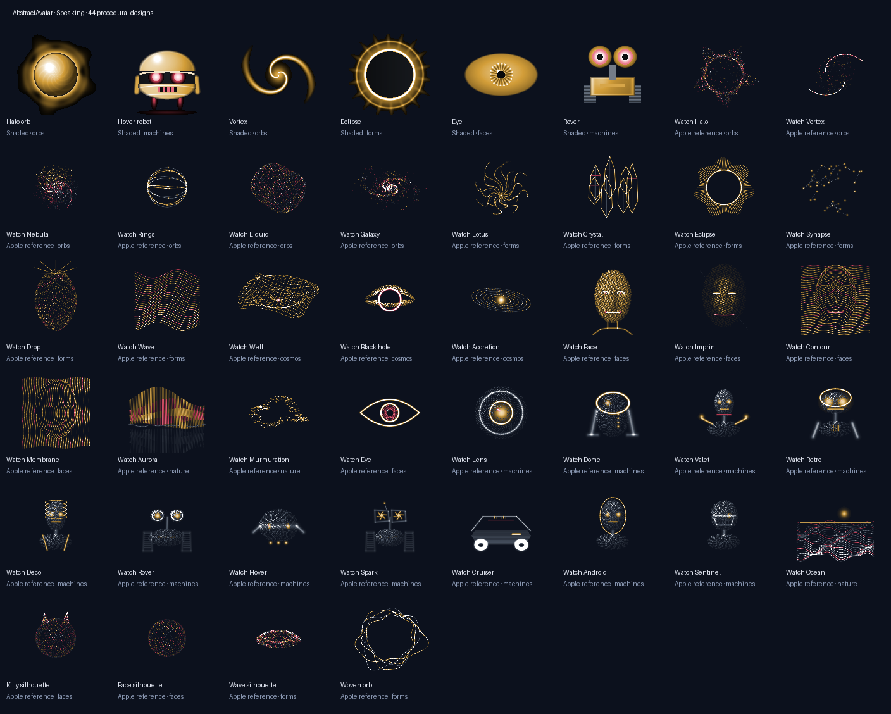

# AbstractAvatar

AbstractAvatar generates procedural avatars from explicit activity state, time, audio level and
gaze. One Rust implementation supplies terminal, browser and native applications with a common
catalog and rendering behavior.

Use it for an assistant portrait, an activity indicator or a procedural character that responds
to your application's state. The host supplies state and presentation; AbstractAvatar generates
the picture locally.



## Start with Python

Build from the repository with Python 3.10+ and Rust 1.87+:

```sh
git clone https://github.com/lpalbou/AbstractAvatar.git
cd AbstractAvatar
python -m pip install .
python -m abstractavatar catalog
python -m abstractavatar render --style halo --state speaking --level 0.6 --size 128 --output avatar.png
```

The Python distribution includes the compiled native library. A source installation builds it
with Cargo. See [getting started](docs/getting-started.md) for library use and platform builds.

## Integrate a player

- **Rust:** create a `Frame` and map its material samples through your theme.
- **Browser:** run the bundled WebAssembly generator and present RGBA pixels on Canvas.
- **Python/native:** request RGBA pixels through the binding or the C interface and present them
  with your UI toolkit.

Store catalog style identifiers, rather than numeric indices. Supply time explicitly, stop
animation while hidden, and use a static frame when reduced motion is enabled. Platform adapters
do not need their own geometry implementations.

The catalog includes shaded characters, particle orbs, forms, portraits, machines, nature scenes
and a woven orb. [Catalog guidance](docs/catalog.md) explains source variants and stable keys.

## Documentation

[Documentation index](docs/README.md) · [Architecture](docs/architecture.md) ·
[API](docs/api.md) · [Frame contract](docs/frame-contract.md) · [FAQ](docs/faq.md) ·
[Troubleshooting](docs/troubleshooting.md) · [Contributing](CONTRIBUTING.md) ·
[Security](SECURITY.md) · [Changelog](CHANGELOG.md)

## For AI agents

Use the [AbstractAvatar skill](skills/abstractavatar/SKILL.md) for the rendering workflow,
descriptor constraints and platform integration rules. The [LLM index](llms.txt) maps the public
documentation.
