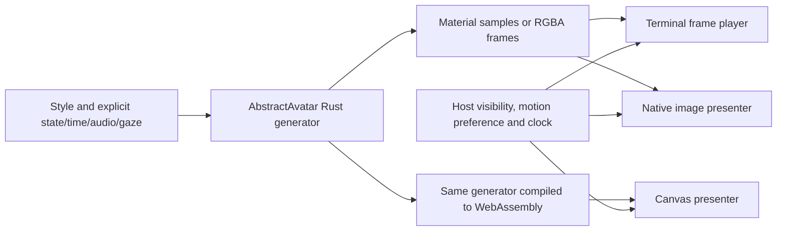

# Architecture

AbstractAvatar owns the catalog and deterministic procedural generation. Hosts own activity
signals, preferences, palette, scheduling and presentation.

The [descriptor](frame-contract.md) selects built-in generation; it does not introduce a new
programming language. Native and WebAssembly builds run the same algorithms. Platform-specific
presenters translate frames into terminal cells, a canvas image or a native image object.

Core generation has no network, microphone, model, timer, global mouse listener or UI-framework
dependency. Gaze and audio levels are inputs supplied by the host. Keeping those responsibilities
explicit lets multiple applications present the same design without sharing application state.

Rendered frames use standard RGBA channel ordering. PNG is used for portable still-image
previews. WebAssembly is the browser execution format; it is not an avatar scene-file format.
The supported formats and limits are specified in [the frame contract](frame-contract.md).

Applications persist stable style keys and resolve numeric ABI codes from the runtime catalog.
See [catalog](catalog.md) and [ADR 0001](adr/0001-portable-procedural-generation.md).
